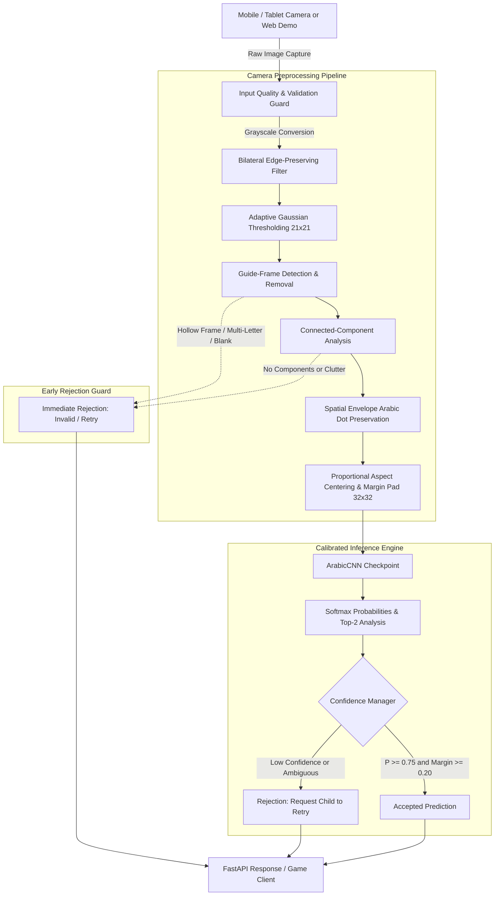
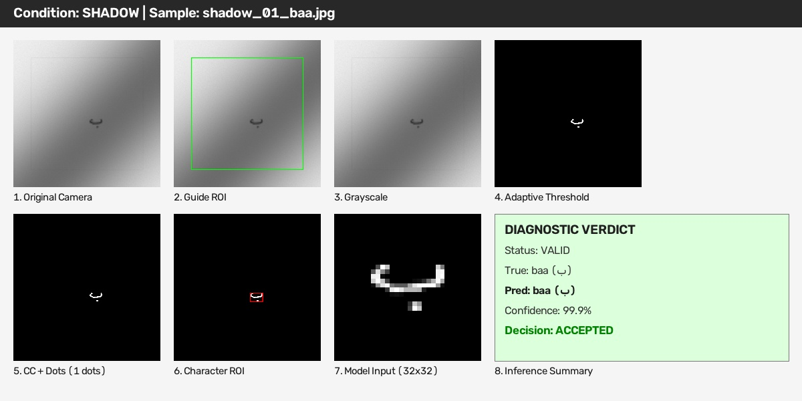
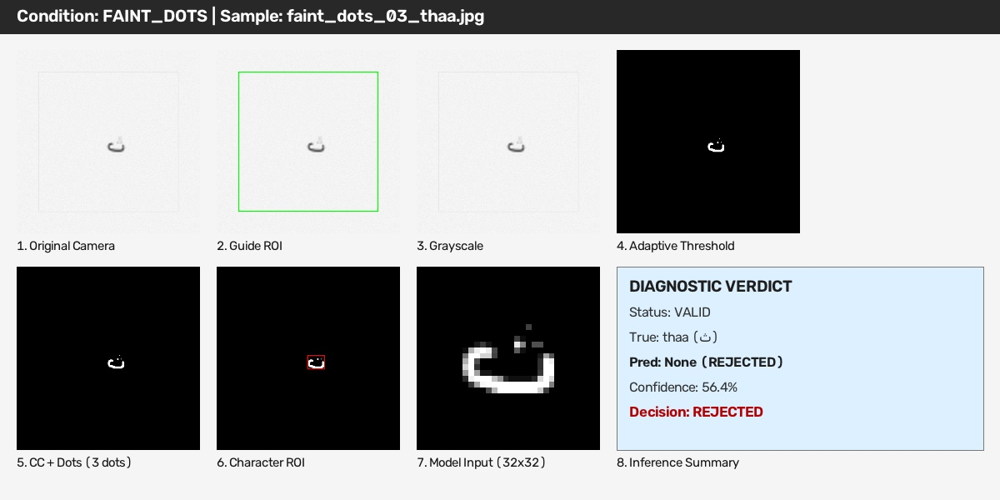
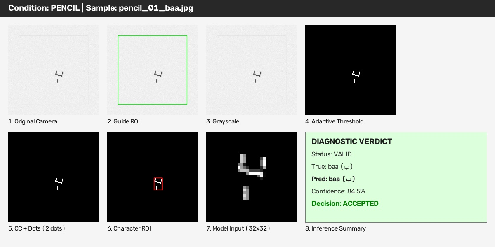
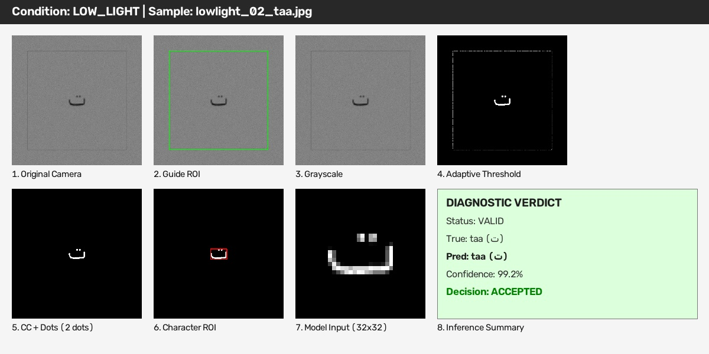
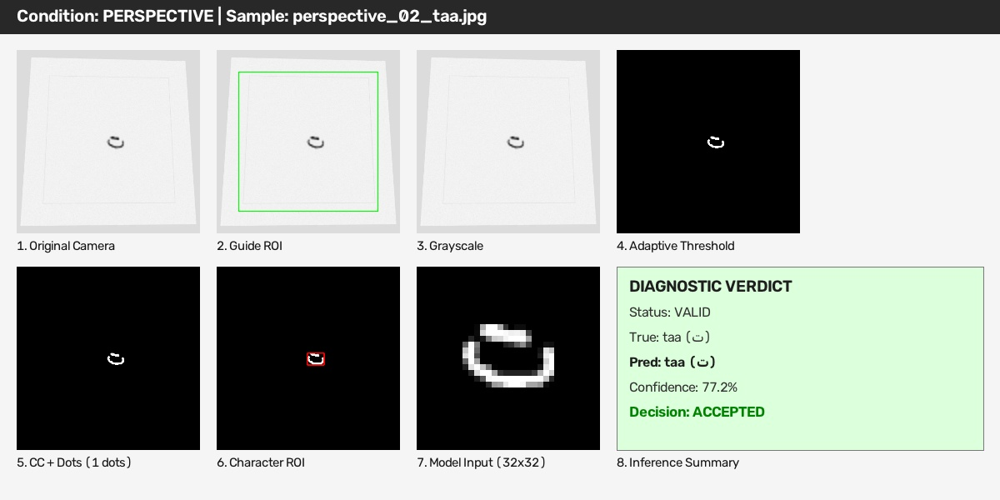

# Arabic Handwritten Letter Recognition for Kids

[](https://www.python.org/)
[](https://fastapi.tiangolo.com/)
[](https://pytorch.org/)
[](https://opencv.org/)
[](#testing)
[](LICENSE)

> **Camera-ready Arabic handwriting recognition with robust computer vision preprocessing, confidence-aware inference, and invalid-input rejection.**

---

## 📌 Project Overview

Recognizing handwritten Arabic characters produced by children in unconstrained mobile capture environments presents significant challenges:

1. **Visually Similar Characters & Critical Dots/Diacritics:** Multiple letters share identical base strokes (*Rasm*) and differ solely by single, double, or triple dots (e.g., ب vs. ت vs. ث, or د vs. ذ, or ر vs. ز). Conventional thresholding and morphology easily erode or detach these tiny dot components.
2. **Children's Handwriting Variability:** High stroke thickness variance, irregular proportions, disconnected dots, and stray pencil marks.
3. **Challenging Mobile Camera Capture Conditions:** Non-uniform lighting, harsh cast shadows, low illumination, perspective tilts, rotational skew, and page guide frame artifacts.

This project implements an end-to-end, camera-oriented Arabic handwritten character recognition engine optimized for isolated characters. It combines an **adaptive computer vision preprocessing pipeline** (featuring dynamic thresholding, guide-frame rejection, and spatial envelope dot preservation) with a calibrated **ArabicCNN classifier** and a **confidence/rejection manager**.

> [!NOTE]
> **Evaluation Scope Notice:** Current camera robustness results are based on **synthetic and camera-like stress testing** (70 stress conditions simulating shadows, pencil strokes, rotation, perspective tilt, low light, and clutter). Validation using real physical phone and tablet camera captures is the planned next evaluation stage.

---

## ✨ Key Features

- **28 Isolated Arabic Character Classes:** Accurate classification across all standard modern Arabic letters (أ to ي).
- **Camera-Oriented Preprocessing Pipeline:**
  - **Bilateral Filtering:** Smooths paper grain and sensor noise while preserving sharp stroke edges.
  - **Adaptive Gaussian Thresholding ($21 \times 21$ window, $C=10$):** Eliminates non-uniform lighting and shadows where standard global Otsu thresholding fails.
  - **Geometric Guide-Frame Rejection:** Automatically detects and rejects 4-corner bounding boxes and printed workbook framing lines.
  - **Diacritical Spatial Envelope Dot Preservation:** Retains tiny Arabic dots (down to 2 pixels) by expanding the search envelope around the main body (horizontal $\times 0.7$, vertical $\times 1.3 / 2.3$).
  - **Aspect-Ratio-Preserving Centering ($\text{margin}=8$):** Resizes letters into standard $32 \times 32$ model inputs without anisotropic stretching or structural distortion.
- **Confidence-Aware Inference & Early Rejection:**
  - **Dual-Threshold Decision Engine:** Employs an acceptance threshold ($T \ge 0.75$) and top-2 margin ($\Delta \ge 0.20$) to filter uncertain outputs.
  - **Invalid & Blank Image Rejection:** 100% detection rate on blank sheets, over-exposed scenes, extreme shadows, and multiple disconnected characters.
- **FastAPI Production-Ready Service:** Asynchronous REST API serving predictions with sub-10ms end-to-end inference latency.
- **Interactive Web Camera Demo:** Built-in mobile-friendly browser interface for live webcam capture or photo upload.
- **Fully Tested & Automated:** 21 automated unit and robustness tests with reproducible synthetic benchmark scripts.

---

## 🏗️ System Architecture



---

## 🔬 Inference Pipeline Details

1. **Input Validation:** Inspects raw image dimensions, channel count, and luminosity histogram.
2. **Edge-Preserving Filtering:** Applies OpenCV bilateral filtering (`d=5`, `sigma_color=50`, `sigma_space=50`) to eliminate paper texture noise without blurring stroke boundaries.
3. **Adaptive Gaussian Thresholding:** Calculates dynamic local thresholds over a $21 \times 21$ neighborhood with subtraction constant $C=10$, creating robust binary representations under sharp shadow gradients.
4. **Hollow Guide-Frame Detection:** Analyzes the outer convex contour. If a rectangular boundary contains 4 corner intersections spanning $>75\%$ of image bounds, it is isolated and removed.
5. **Component Clustering & Dot Preservation:** 
   - Identifies the main character body (largest connected component).
   - Establishes a spatial bounding envelope: horizontal margins extended by $0.7 \times W$, top margin extended by $1.3 \times H$, bottom margin extended by $2.3 \times H$.
   - Any secondary connected components within this envelope having an area $\ge 2\text{ px}$ are classified as critical dots/diacritics and merged with the base letter.
6. **Proportional Resizing:** Normalizes the merged character onto a $32 \times 32$ canvas using uniform scaling with a fixed margin of 8 pixels, preserving aspect ratios and stroke geometry.
7. **Model Inference:** Passes the $1 \times 32 \times 32$ tensor through `ArabicCNN`.
8. **Decision Logic:** Employs the `ConfidenceManager` to classify outputs into `ACCEPTED`, `REJECTED_LOW_CONFIDENCE`, or `REJECTED_INVALID_INPUT`.

---

## 🧠 Model Architecture

The core recognition model is **ArabicCNN** (`ml/models/final_candidate_model.pt`), a lightweight custom convolutional architecture designed specifically for 32×32 single-channel Arabic handwriting.

```text
Input (1 × 32 × 32 Grayscale)
  │
  ├── Conv2D(1 → 32, kernel=3, padding=1) + BatchNorm2d + ReLU
  ├── Conv2D(32 → 32, kernel=3, padding=1) + BatchNorm2d + ReLU
  ├── MaxPool2d(2 × 2) + Dropout(0.25)
  │
  ├── Conv2D(32 → 64, kernel=3, padding=1) + BatchNorm2d + ReLU
  ├── Conv2D(64 → 64, kernel=3, padding=1) + BatchNorm2d + ReLU
  ├── MaxPool2d(2 × 2) + Dropout(0.25)
  │
  ├── Conv2D(64 → 128, kernel=3, padding=1) + BatchNorm2d + ReLU
  ├── MaxPool2d(2 × 2) + Dropout(0.25)
  │
  ├── Flatten
  ├── Linear(128 × 4 × 4 = 2048 → 256) + BatchNorm1d + ReLU + Dropout(0.50)
  └── Linear(256 → 28) → Logits / Softmax Output
```

- **Input Format:** Grayscale single-channel tensor normalized to $[0.0, 1.0]$, shape `[B, 1, 32, 32]`.
- **Output:** 28 class probability distribution corresponding to the Arabic alphabet.
- **Model Checkpoint Size:** 8.97 MB.

---

## 📊 Benchmark & Evaluation Results

### Core Performance Metrics

The system was evaluated against a camera-stress test suite comprising 70 challenging conditions (63 valid handwriting captures across adverse optical environments and 7 invalid/blank stress inputs).

| Metric | Result | Notes / Details |
| :--- | :---: | :--- |
| **Accepted Prediction Accuracy** | **85.11%** | Accuracy on samples cleared by the Confidence Manager (40 / 47) |
| **Overall Valid-Character Accuracy** | **63.49%** | Unfiltered recognition across all 63 valid stress samples (40 / 63) |
| **False Acceptance Rate (FAR)** | **11.11%** | Wrong predictions accepted with high confidence (7 / 63) |
| **Rejection Rate** | **25.40%** | Samples correctly flagged for child retry (16 / 63) |
| **Invalid Input Detection Rate** | **100.00%** | Blanks, clutter, and non-letter inputs safely rejected (7 / 7) |
| **Dot / Diacritic Preservation** | **100.00%** | Faint-dot stress tests preserved without erosion (8 / 8) |
| **Preprocessing Latency (mean)** | **4.56 ms** | OpenCV CPU pipeline execution time |
| **Model Inference Latency (mean)**| **3.70 ms** | PyTorch CPU forward pass |
| **End-to-End Latency (mean)** | **8.26 ms** | Full pipeline per-frame latency |
| **Automated Test Suite** | **21 Passed** | Unit, integration, and camera robustness tests |

> [!IMPORTANT]
> **Understanding the Accuracy Distinction:**
> - **Overall Accuracy (63.49%):** Reflects unfiltered stress testing under extreme lighting, skew, and low-contrast conditions.
> - **Accepted Accuracy (85.11%):** In an educational children's application, asking a child to *"Please try again"* is far preferable to confirming an incorrect letter. When the confidence manager accepts a prediction, accuracy rises to **85.11%**.

### Robustness Breakdown by Environmental Condition

*Results extracted directly from `ml/evaluation/camera_benchmark.json`:*

| Condition | Samples | Correct | Wrong | Rejected | Accuracy | Rejection Rate |
| :--- | :---: | :---: | :---: | :---: | :---: | :---: |
| **Clean** | 8 | 4 | 2 | 2 | 50.0% | 25.0% |
| **Shadow** | 6 | 5 | 0 | 1 | 83.3% | 16.7% |
| **Low Light** | 5 | 5 | 0 | 0 | 100.0% | 0.0% |
| **Pencil Stroke** | 5 | 4 | 1 | 0 | 80.0% | 0.0% |
| **Faint Dots** | 8 | 6 | 0 | 2 | 75.0% | 25.0% |
| **Perspective Tilt** | 5 | 3 | 0 | 2 | 60.0% | 40.0% |
| **Bright Light** | 4 | 2 | 1 | 1 | 50.0% | 25.0% |
| **Small Letter** | 4 | 2 | 0 | 2 | 50.0% | 50.0% |
| **Large Letter** | 4 | 3 | 1 | 0 | 75.0% | 0.0% |
| **Rotation ($\ge 20^\circ$)** | 5 | 2 | 1 | 2 | 40.0% | 40.0% |
| **Clutter** | 4 | 1 | 0 | 3 | 25.0% | 75.0% |
| **Blank Page** | 4 | 0 | 0 | 4 | N/A | **100.0%** |
| **Invalid Input** | 3 | 0 | 0 | 3 | N/A | **100.0%** |

---

## 🖼️ Visual Preprocessing Pipeline Diagnostics

The adaptive preprocessing pipeline isolates characters from realistic camera degradation without stripping diacritical dots. Each diagnostic panel below illustrates:
1. **Original Image:** Raw camera input with optical distortion or shadow.
2. **Thresholded:** Local adaptive binary segmentation.
3. **Connected Components:** Bounding boxes detecting base character and secondary dots.
4. **Final Model Input:** Uniformly centered $32 \times 32$ tensor ready for inference.

### 1. Harsh Shadow Gradient

*Adaptive Gaussian thresholding isolates strokes seamlessly across steep illumination gradients where global Otsu fails.*

### 2. Faint Diacritical Dots Preservation

*The spatial envelope algorithm detects and preserves small diacritical dots down to 2 pixels.*

### 3. Light Pencil Stroke Contrast

*Bilateral edge-preserving smoothing retains low-contrast pencil marks while suppressing paper grain.*

### 4. Low Ambient Light

*Even under poor illumination, dynamic windowing extracts character strokes clearly.*

### 5. Perspective Distortion

*Demonstrates aspect-ratio-preserving centering and component isolation under camera angle tilt.*

---

## 🚀 Installation & Setup

### Prerequisites
- Python 3.11, 3.12, or 3.13
- Git

### 1. Clone the Repository
```bash
git clone https://github.com/Ali-Developments/Arabic-Letter-Recognition-for-Kids.git
cd Arabic-Letter-Recognition-for-Kids
```

### 2. Create and Activate Virtual Environment
**On Windows:**
```powershell
python -m venv .venv
.venv\Scripts\activate
```

**On Linux / macOS:**
```bash
python3 -m venv .venv
source .venv/bin/activate
```

### 3. Install Dependencies
```bash
pip install --upgrade pip
pip install -r requirements.txt
```

### 4. Configure Environment
```bash
cp .env.example .env
```

---

## ⚡ Running the API & Web Demo

Start the FastAPI application with Uvicorn:

```bash
uvicorn --app-dir backend app.main:app --host 0.0.0.0 --port 8000 --reload
```

Once started, access the following in your browser:
- **Interactive Swagger Documentation:** [http://127.0.0.1:8000/docs](http://127.0.0.1:8000/docs)
- **Interactive Camera Web Demo:** [http://127.0.0.1:8000/demo/index.html](http://127.0.0.1:8000/demo/index.html)
- **Health Check Endpoint:** [http://127.0.0.1:8000/health](http://127.0.0.1:8000/health)

---

## 📱 Testing from a Phone or Tablet

To test the system live using your smartphone or tablet's camera:

1. Connect your mobile device and computer to the **same local Wi-Fi network**.
2. Find your computer's local IPv4 address:
   - **Windows:** Run `ipconfig` (look for *IPv4 Address*, e.g., `192.168.1.15`).
   - **Linux/macOS:** Run `ifconfig` or `ip a` (e.g., `192.168.1.15`).
3. Launch the API bound to all network interfaces (`0.0.0.0`):
   ```bash
   uvicorn --app-dir backend app.main:app --host 0.0.0.0 --port 8000
   ```
4. Open your mobile browser and navigate to:
   ```text
   http://YOUR_PC_IP:8000/demo/index.html
   ```
   *(e.g., `http://192.168.1.15:8000/demo/index.html`)*
5. You can take a live photo using your phone camera or upload a saved picture. The interactive demo will immediately display the predicted Arabic letter, English transliteration, confidence score, and preprocessed debug view.

---

## 📡 API Usage & Endpoints

### Recognize Letter Endpoint
`POST /api/v1/recognize-letter`

Accepts a multipart form submission containing an image file.

#### Example Request (`curl`)
```bash
curl -X POST "http://127.0.0.1:8000/api/v1/recognize-letter" \
  -H "accept: application/json" \
  -F "file=@sample_letter.png;type=image/png"
```

#### Successful Accepted Response (`200 OK`)
```json
{
  "status": "success",
  "prediction": "ب",
  "confidence": 0.9421,
  "top2_margin": 0.8814,
  "status_code": "ACCEPTED",
  "message": "Prediction accepted with high confidence.",
  "top_k": [
    { "letter": "ب", "confidence": 0.9421 },
    { "letter": "ت", "confidence": 0.0607 },
    { "letter": "ث", "confidence": 0.0012 }
  ],
  "latency_ms": 7.84
}
```

#### Low Confidence / Retry Response (`200 OK`)
```json
{
  "status": "retry",
  "prediction": "د",
  "confidence": 0.6120,
  "top2_margin": 0.0840,
  "status_code": "REJECTED_LOW_CONFIDENCE",
  "message": "Confidence is below the acceptance threshold. Please ask the child to redraw or recapture.",
  "top_k": [
    { "letter": "د", "confidence": 0.6120 },
    { "letter": "ذ", "confidence": 0.5280 }
  ],
  "latency_ms": 8.12
}
```

#### Invalid Input / Rejection Response (`200 OK`)
```json
{
  "status": "rejected",
  "prediction": null,
  "confidence": 0.0,
  "top2_margin": 0.0,
  "status_code": "REJECTED_INVALID_INPUT",
  "message": "Image rejected: Blank page or no character detected.",
  "top_k": [],
  "latency_ms": 4.20
}
```

---

## 🧪 Testing

The repository maintains an automated test suite verifying preprocessing, model inference, confidence gates, API endpoints, and camera stress robustness.

To run the complete test suite:
```bash
pytest -v
```

### Test Coverage Highlights:
- **13 Core Preprocessing & API Tests:** Dot preservation, aspect-ratio scaling, API schemas, model loading, and confidence calibrations.
- **8 Camera Robustness Tests:** Adaptive thresholding under shadows, hollow guide-frame removal, low-light resilience, multi-character rejection, and blank page detection.
- **Current Status:** `21 passed in ~8.5s`.

---

## 📁 Repository Structure

```text
Arabic-Letter-Recognition-for-Kids/
├── .github/
│   └── workflows/
│       └── tests.yml              # CI automated pytest workflow
├── backend/
│   ├── app/
│   │   ├── main.py                # FastAPI entrypoint & router
│   │   ├── core/                  # Configuration & inference settings
│   │   ├── models/                # Pydantic request/response schemas
│   │   └── services/              # Inference orchestrator & confidence manager
│   └── requirements.txt           # Backend-specific requirements
├── demo/
│   ├── index.html                 # Mobile-friendly web camera capture UI
│   ├── app.js                     # Capture logic & API communication
│   └── style.css                  # UI styling
├── docs/
│   └── images/                    # Visual preprocessing diagnostic figures
├── ml/
│   ├── evaluation/
│   │   ├── camera_benchmark.json  # Comprehensive stress test metrics
│   │   ├── camera_results.csv     # Granular condition-by-condition log
│   │   └── evaluate_camera_pipeline.py # Benchmark execution script
│   ├── models/
│   │   ├── arabic_cnn.py          # PyTorch ArabicCNN model definition
│   │   └── final_candidate_model.pt # Trained model weights checkpoint
│   └── preprocessing/
│       ├── camera_pipeline.py     # Variant B adaptive camera preprocessing
│       └── dot_preservation.py    # Spatial envelope dot extraction algorithms
├── tests/
│   ├── test_api.py                # FastAPI endpoint integration tests
│   ├── test_camera_pipeline.py    # Camera stress & robustness unit tests
│   └── test_preprocessing.py      # Base preprocessing unit tests
├── .env.example                   # Environment configuration template
├── .gitignore                     # Production Python/ML ignore rules
├── LICENSE                        # MIT License
├── README.md                      # Project documentation
└── requirements.txt               # Project dependencies
```

---

## ⚠️ Limitations

- **Isolated Characters Only:** The system is explicitly designed for isolated Arabic letters and does not support cursive, joined-word text (*Khat* / handwriting recognition).
- **Extreme Rotational Skew:** Rotations exceeding $\pm 20^\circ$ significantly alter character baseline orientations and may lead to classification degradation.
- **Perspective Tilt:** Extreme oblique camera angles (e.g., $>35^\circ$ angle to the paper plane) distort aspect ratios beyond the tolerance of standard 2D bounding boxes.
- **Physical Mobile Camera Dataset:** All current camera benchmarks reflect **synthetic and camera-like stress tests**. Validation on a physical corpus captured across diverse real-world mobile devices remains the next evaluation milestone.

---

## 🗺️ Project Roadmap

- [x] Arabic character recognition CNN architecture
- [x] Adaptive camera preprocessing (Bilateral + Local Gaussian)
- [x] Spatial envelope Arabic dot & diacritic preservation
- [x] Dual-threshold confidence & rejection manager
- [x] FastAPI inference service with sub-10ms response
- [x] Synthetic camera stress benchmarking (70 conditions)
- [x] Comprehensive automated test suite (21 tests)
- [ ] Physical mobile-camera dataset collection & validation
- [ ] On-device mobile inference (CoreML / ONNX Runtime / TFLite)
- [ ] Extended data collection for younger preschool age groups
- [ ] Rotational invariance enhancement via spatial transformer modules

---

## 📜 Dataset & Licensing

- **Software Source Code:** Licensed under the [MIT License](LICENSE).
- **Training Datasets Notice:**
  - This project was trained on the **Hijja** dataset (*handwritten Arabic letters written by children aged 7–12*) and the **AHCD** (*Arabic Handwritten Characters Dataset*).
  - All rights to the original datasets belong to their respective academic authors and institutions. Dataset files are not distributed within this repository.

---

## 👤 Author

**Ali Mostafa Ali**  
GitHub: [@Ali-Developments](https://github.com/Ali-Developments)
